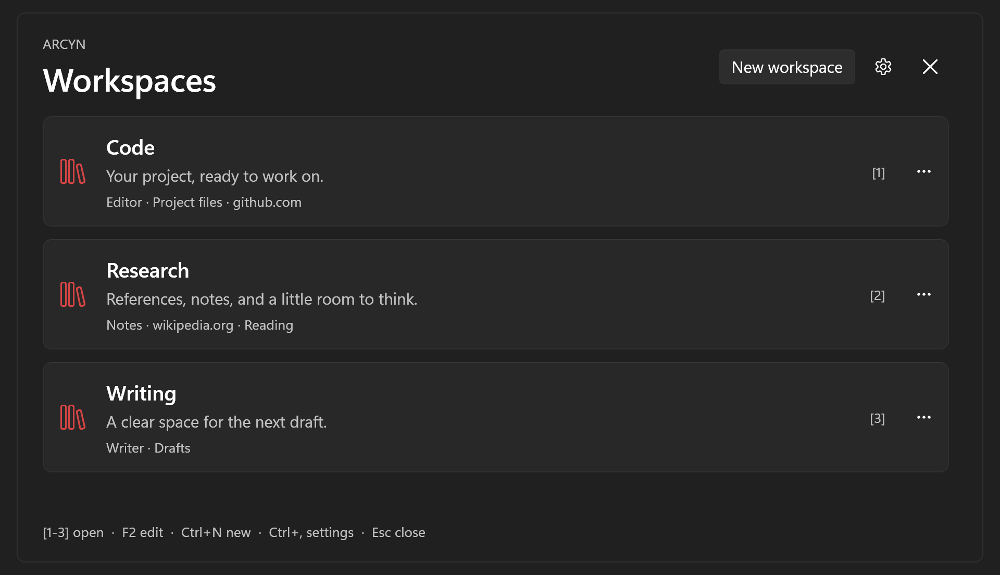
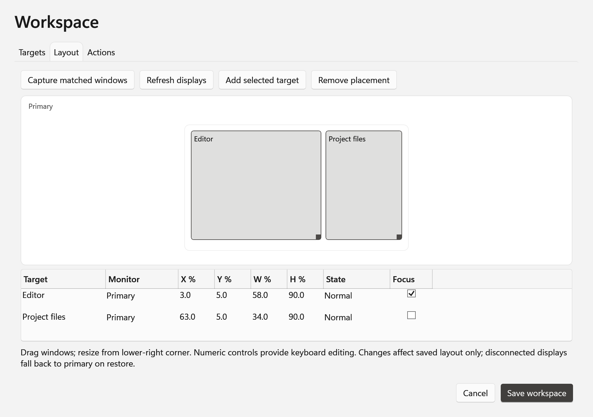

#  ARCYN

**A Windows workspace launcher for the apps, folders, and websites you use together.**

*Workspaces for coding, research, and writing.*

## Start with your workspace

Your editor, a project folder, a few reference pages. Save them as a workspace, then bring them together with a click or a number key. Keep another workspace for research, writing, or whatever comes next.

- **Open things together.** Group applications, folders, files, and websites around a task.
- **Use what's already open.** ARCYN can reuse a matching application window instead of launching another copy. You can also choose to always launch a new one.
- **Put windows in place.** Capture a layout, adjust it visually, and restore it when you open that workspace.

A cinematic opening leads into a keyboard-friendly workspace list, with familiar Windows controls throughout.

*The layout editor changes your saved arrangement. Editing the preview doesn't move your windows.*

## Get v1.6.0

**The stable v1.6.0 package is prepared but has not been published.** Final release acceptance checks remain open. The [older `.exe` release](https://github.com/bugged-bit/Arcyn/releases/tag/app) is a previous version, not v1.6.0.

Public packages will be listed on [Releases](https://github.com/bugged-bit/Arcyn/releases). Until publication, review builds are available through GitHub Actions: **sign-in is required, artifacts expire, and availability isn't guaranteed.**

1. Open [branch builds](https://github.com/bugged-bit/Arcyn/actions/workflows/dotnet-build.yml?query=branch%3Acodex%2Farcyn-lightweight) and select a successful v1.6.0 run for `codex/arcyn-lightweight`.
2. Download **ARCYN-v1.6.0-win-x64**. Extract the artifact download, then extract the enclosed **ARCYN-v1.6.0-win-x64.zip** to a permanent folder you can write to. A SHA-256 file accompanies the inner ZIP; [verification instructions](docs/guide.md#verify-the-archive) are in the guide.
3. Run **ARCYN.exe**. Name your first workspace and add the apps, folders, and websites you want. Optional setup steps have **Skip**.
4. Choose the workspace or press its number to open it.

Keep the extracted files together. The ZIP includes its runtime; no separate .NET installation is needed. The build is unsigned, so Windows may warn or block it. Only run a download whose source you trust. [Download guidance and release status →](docs/guide.md#downloads-and-windows-warnings)

## Make it yours

ARCYN targets **Windows 10/11 x64**. Appearance follows Windows by default, with light, dark, accent, text-size, and motion settings available. Ordinary shortcuts work without a resident helper; a global hotkey is optional.

| Key | Action |
| --- | --- |
| `1`–`9` | Open a workspace |
| Arrow keys, `Enter` | Select and open |
| `Esc` | Cancel a launch or close ARCYN |
| `F2` / `Ctrl+N` | Edit / create a workspace |
| `Ctrl+,` | Open settings |

[User guide](docs/guide.md) · [Release notes and testing status](docs/release-notes.md)

## Open source

Found a rough edge? [Report a problem](https://github.com/bugged-bit/Arcyn/issues/new?template=bug_report.md) or [suggest an improvement](https://github.com/bugged-bit/Arcyn/issues/new?template=feature_request.md). Contributions to code, documentation, and testing are welcome; start with [contributing](CONTRIBUTING.md).

ARCYN is [MIT licensed](LICENSE), built with .NET and WPF, and uses Microsoft's Fluent controls. [Third-party credits and licenses](https://github.com/bugged-bit/Arcyn/blob/codex/arcyn-lightweight/ARCYN/Notices/README.txt) accompany the application.
