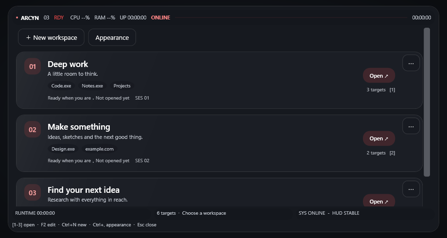

# ARCYN

ARCYN is a cinematic workspace launcher for Windows 10/11 x64. Its workspace view, editors, setup and settings use Microsoft's Fluent WPF controls, Windows appearance and accent colors, Segoe UI Variable and familiar window behavior. The opening and launch sequences retain ARCYN's personality and deliberate timing. **1.6.0-rc.1 is a locally tested release candidate; clean-Windows and remaining platform acceptance checks are still required before public release.** See [release notes](docs/release-notes.md).

Extract the **complete standalone ZIP** to a permanent folder you can write to, then run ARCYN.exe. Keep all runtime files and `Notices` beside it; no separate .NET runtime, AutoHotkey or VC redistributable installation is required. First run opens the setup wizard. For an upgrade, close ARCYN, extract to a separate empty folder and point shortcuts there; AppData configuration stays in place. This candidate is unsigned; no public release is being published by this change.

Setup's Apps, Folders and Websites steps each offer **Skip**. Items already added are kept; pending text is left out when skipping. **Next** adds a pending app path or valid website address before continuing. Enter activates the primary action, and each step focuses its relevant control.

See the [live validation status and remaining release gates](docs/live-validation.md).

Default mode leaves **zero ARCYN processes** after closing. Ordinary Desktop, Start-menu and pinned Windows shortcuts need no resident ARCYN helper.



Actual WPF interface rendered offscreen with synthetic workspaces and opaque surfaces. This does not show native desktop glass. [Layout editor](docs/previews/layout-offscreen.png) · [Appearance](docs/previews/appearance-offscreen.png).

- 1–9 launch a workspace; arrows select; Enter launches; Esc cancels or closes.
- New workspace and Settings are visible on the workspace view. F2 edits a workspace; Ctrl+N adds one. Use a card's ⋯ menu or right-click to edit, duplicate, reorder or delete it. Shift+F10 / the context-menu key opens actions for the focused card.
- Ctrl+, opens Settings. General, Appearance and Motion group everyday preferences and advanced customization. Appearance follows Windows by default, with Light, Dark and Custom alternatives. Windows accent is the default; custom accent/color/font values remain saved and editable. Windows contrast policy overrides visual preferences without rewriting them. Native materials have an intentional opaque fallback.
- Live previews are coalesced while the editor is open. Apply saves; Cancel restores. Import/export uses visual JSON only.
- Reduced effects preserve boot/launch durations and choreography. Cinematic ambient effects stop in the workspace view; disabled idle closing also stops its timer.
- The workspace editor groups **Targets**, **Layout** and **Actions**. Targets keep exact arguments, working directories, browsing and on-demand discovery. Selected-item controls expose instance policies, window selectors, readiness, timeout and prerequisites.
- Applications default to **Reuse or launch**; **Reuse only** and **Launch new** are explicit alternatives. Matching uses executable/application identity, optionally narrowed by window class/title. Ambiguous or inaccessible matches report a failure instead of duplicating blindly. Reuse does not send new arguments or open a new document in an existing window. Aliases/brokers may require an explicit matching executable selected from a running window.
- **Capture matched windows** reads window arrangements into an unsaved editor draft. The monitor map and numeric table edit saved intent without moving windows. Restore scales work-area-relative geometry, retains show state and uses the primary display if a saved monitor is absent; fallback is reported without changing the saved preference.
- Typed window operations, fixed/window waits and explicitly reviewed commands form small workflows. Dependencies run deterministically; failed prerequisites skip dependents while independent steps continue. Application readiness requires a unique responsive window by default (30-second timeout). This proves window availability, not that a document or network task has finished loading. URLs/files/folders report **Dispatched** unless matching window evidence is configured.
- Right-click **Windows** to attach running windows, reapply a layout, minimize managed windows, restore windows ARCYN minimized, or release ownership. Switching leaves outgoing windows alone. Ownership lasts only for the current ARCYN process; reopening requires fresh attachment. ARCYN never closes applications or discards unsaved work.
- Commands and recognized script/interpreter targets require review on every run; configuration cannot grant approval. Elevated commands additionally request UAC. Timeouts/cancellation stop further orchestration, leave dispatched work running, and retain uncertain dispatches to prevent silent retry. **Last run details** keeps failures and focus/placement warnings accessible; automatic closing requires a successful run.

Run `scripts/Setup-Shortcuts.ps1` to create Desktop and Start-menu shortcuts. This does not start a process or install a helper. Windows also supports assigning Ctrl+Alt combinations in shortcut Properties.

For dependable Alt+Shift+D, optionally run `ARCYN.Hotkey.exe` beside ARCYN.exe. It uses native RegisterHotKey and a blocking message wait. Change the combination with `--hotkey CTRL+ALT+D`; stop with `--stop`. Conflicts are reported. Win combinations and F12 are reserved. To enable it at the next sign-in, run `scripts/Setup-Shortcuts.ps1 -EnableHotkeyHelper`; remove it with `-DisableHotkeyHelper`. It is never enabled automatically.

Configuration uses one selected path for both reads and saves:

1. Explicit `--config "path/to/arcyn.json"`.
2. Existing `%APPDATA%\ARCYN\arcyn.json`.
3. Existing arcyn.json beside the executable.
4. Legacy protocoll.json beside the executable, in its ARCYN child folder or its parent folder. Legacy data stays intact; subsequent edits save to AppData unless explicitly selected.

An explicit path must already exist. A new installation saves to AppData. The current working directory does not choose a configuration. `--config-path` prints the selected save location. Atomic saves retain the previous file as .bak. Malformed or newer-schema files are preserved and reported, never replaced by setup defaults. Copy a known-good .bak over the damaged file after keeping a copy of the damaged file.

Schema 1, legacy workspace arrays and upstream apps/websites/folders remain readable. Ordinary saves write schema 2 with stable IDs, layouts and typed actions; earlier releases reject schema 2. Loading alone does not rewrite configuration. Prefer ordered targets for new work:

Saved workspaces use `label` and `subtitle`. The older `name` and `description` aliases remain readable; if both forms occur, their values must agree.

```json
{
  "schema_version": 2,
  "modes": [
    {
      "label": "CODE",
      "subtitle": "Development workspace",
      "type": "code",
      "session": "SES 089",
      "state": "Ready to build",
      "targets": [
        { "cmd": "wt.exe", "args": [] },
        { "cmd": "https://github.com", "args": [] }
      ]
    }
  ]
}
```
Unavailable targets stay saved and can be repaired. Existing literal paths take precedence over command-line parsing. Ambiguous legacy strings require editing; shell metacharacters are not interpreted as a shell script. A command that needs an interpreter must select its executable explicitly. Dispatched targets require a distinct matching window for window readiness; existing browser tabs and document readiness are not inferred. [The example](https://github.com/bugged-bit/Arcyn/blob/codex/arcyn-lightweight/ARCYN/example.arcyn.json) shows typed targets and waits; [the schema](https://github.com/bugged-bit/Arcyn/blob/codex/arcyn-lightweight/ARCYN/arcyn.schema.json) also describes selectors, commands and layouts.

Use `ARCYN --setup` in a terminal for line-based setup (appends to existing workspaces; EOF exits). Other flags: --help, --version, --config-path, --config. Duplicate startup activates the existing window. Logs are bounded and nonfatal under %LOCALAPPDATA%\ARCYN.

Development requires the SDK pinned in global.json. C++ build tools are needed only to build the optional native helper. From the repository root:
```powershell
./ARCYN/tools/Test-Arcyn.ps1
./ARCYN/tools/Publish-Arcyn.ps1
```
The regression runner opens no windows or target applications. Publishing creates and checks a complete standalone ZIP. CI runs these commands for master, codex/arcyn-lightweight and pull requests targeting master.

See [validation and performance notes](docs/implementation-validation.md). WPF remains the framework; Windows interop stays in the existing services. Linux support and a framework migration are outside this change.

The standalone artifact bundles .NET 10 LTS runtime 10.0.13; the development SDK is pinned to 10.0.402. Updating a self-contained release requires republishing its bundled runtime. The known-good .NET 8 checkpoint is Git tag `arcyn-net8-validated` (`01b75e9`), with one retained local release ZIP. Use Git for source recovery; build outputs are disposable. Keep user configuration and valuable uncommitted files outside cleanup operations.
