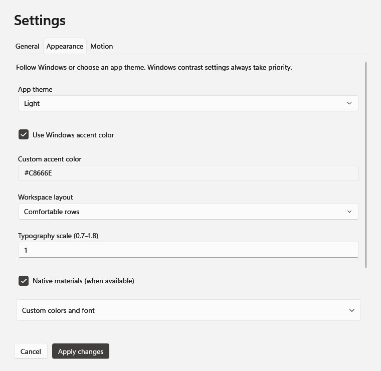

# ARCYN user guide

[← Back to ARCYN](../README.md)

The interface images use ARCYN's production WPF controls with sample workspaces, rendered offscreen without opening applications. They show the real interface; desktop-dependent materials are not represented.

## Downloads and Windows warnings

**The unsigned stable v1.6.0 package is prepared but not yet published.** Successful v1.6.0 runs of the [branch build workflow](https://github.com/bugged-bit/Arcyn/actions/workflows/dotnet-build.yml?query=branch%3Acodex%2Farcyn-lightweight) provide review artifacts. GitHub requires sign-in to download them. They expire and may be unavailable; they are not a permanent release channel. If no artifact is available, follow the [build instructions](../CONTRIBUTING.md#run-the-project).

Download the **ARCYN-v1.6.0-win-x64** artifact and extract GitHub's wrapper ZIP first. Inside are the application archive, **ARCYN-v1.6.0-win-x64.zip**, and its **.zip.sha256** file. Verify the inner ZIP below, then extract it, including its top-level folder, and keep everything together. It includes the .NET/WPF runtime and `Notices`; you don't need to install .NET, AutoHotkey, or a VC redistributable separately.

Future public ZIPs will be listed on [Releases](https://github.com/bugged-bit/Arcyn/releases). The existing release tagged `app` is an older `.exe` build and does not contain v1.6.0. GitHub's automatic source-code archives are not runnable application packages.

Unsigned builds have no verified publisher identity. Windows SmartScreen may show an unrecognized-app warning, and Smart App Control or managed-device policy may block execution. Download only from this repository, confirm the intended build, and follow your device's security policy. ARCYN makes no claim of signing or established SmartScreen reputation. See [Microsoft's explanation](https://learn.microsoft.com/en-us/windows/apps/package-and-deploy/smartscreen-reputation).

Clean Windows installation, broader Windows-version, mixed-DPI, and assistive-technology acceptance checks remain outstanding. Consult the [release notes](release-notes.md) for the detailed testing status.

### Verify the archive

Run this in the folder containing the inner application ZIP and its checksum file:

```powershell
$expected = (Get-Content -LiteralPath './ARCYN-v1.6.0-win-x64.zip.sha256').Split(' ')[0]
$actual = (Get-FileHash -LiteralPath './ARCYN-v1.6.0-win-x64.zip' -Algorithm SHA256).Hash
if ($actual -ine $expected) { throw 'Archive checksum mismatch; do not run this download.' }
```

A match confirms that the archive agrees with the accompanying checksum. It does not establish a publisher identity or replace signing. Each CI build records its own checksum; don't compare archives from different runs.

## Your first workspace

Run `ARCYN.exe` from the extracted folder. Setup asks for a workspace name, then apps, folders, and websites. **Next** includes a pending app path or valid website. **Skip** leaves out pending text but keeps items you've already added. Finish saves the workspace.

Use **New workspace** to add another, **F2** to edit, or a workspace's **⋯** menu to duplicate, reorder, or delete it. Right-click or **Shift+F10** opens the same actions. Deleting a workspace removes its definition; it doesn't close applications or delete files.

The editor has three pages:

- **Targets** — apps, files, folders, and websites, with optional arguments and launch settings.
- **Layout** — capture matched windows or edit their saved positions. The preview changes saved intent without moving your windows. A missing monitor falls back to the primary display when restoring.
- **Actions** — optional window operations, waits, and commands for workflows that need an order.

Applications normally use **Reuse or launch**. Choose **Reuse only** or **Launch new** when needed. Reuse requires an identifiable matching window; ambiguous matches ask for repair. It does not send new arguments to an existing window, reopen a document there, or infer existing browser tabs. Advanced matching is under the selected target's options.

If a launch needs attention, open **Workspace menu → Last run details**. Cancel stops further orchestration and leaves anything already opened running. ARCYN never closes your applications to switch workspaces.

## Appearance and shortcuts

Open Settings with **Ctrl+,**. General controls launcher behavior; Appearance controls theme, accent, layout, and text size; Motion controls effects. **Apply** saves changes; **Cancel** restores the previous appearance. Windows contrast settings take priority. Native materials fall back to opaque surfaces when unavailable. Reduced effects preserve the opening and launch durations.

[](previews/appearance-offscreen.png)

*Production interface rendered offscreen with sample settings; native desktop materials are not shown.*

The extracted package includes `scripts/Setup-Shortcuts.ps1` for Desktop and Start-menu shortcuts. From the package folder, run:

```powershell
./scripts/Setup-Shortcuts.ps1
```

Ordinary shortcuts need no resident helper. For an optional global hotkey, run `ARCYN.Hotkey.exe` beside `ARCYN.exe`; its default is **Alt+Shift+D**. A custom combination can be supplied as `--hotkey CTRL+ALT+D`, and `--stop` stops the helper. Conflicts are reported.

To enable the helper at your next sign-in, use `./scripts/Setup-Shortcuts.ps1 -EnableHotkeyHelper`; remove that startup entry with `-DisableHotkeyHelper`. It is never enabled automatically. These scripts intentionally change your shortcuts, so run them only when you want that setup.

## Configuration, upgrades, and recovery

A new installation saves to `%APPDATA%\ARCYN\arcyn.json`. Existing configurations are selected in this order:

1. An explicit `--config "path\arcyn.json"` (the file must exist).
2. `%APPDATA%\ARCYN\arcyn.json`.
3. `arcyn.json` beside the executable.
4. Legacy `protocoll.json` beside the executable, in its `ARCYN` child folder, or in its parent folder.

Reads and saves use the selected location. Legacy `protocoll.json` stays intact; subsequent edits save to AppData unless you selected an explicit path. The working directory doesn't choose the configuration. `ARCYN.exe --config-path` prints the save location.

To upgrade, close ARCYN, back up your configuration, extract the complete new ZIP into a separate empty folder, and update shortcuts to point there. AppData configuration remains in place. Saves write schema 2; older versions cannot read that schema. Loading alone doesn't rewrite a file.

Atomic saves retain the previous configuration as `.bak`. If a file is damaged, keep a copy of it, then copy a known-good backup over it. Malformed and newer-schema configurations are reported and preserved, rather than replaced by setup defaults.

Most users can stay in the editor. For manual configuration, the package includes `example.arcyn.json` and `arcyn.schema.json`; the [source example](https://github.com/bugged-bit/Arcyn/blob/codex/arcyn-lightweight/ARCYN/example.arcyn.json) and [schema](https://github.com/bugged-bit/Arcyn/blob/codex/arcyn-lightweight/ARCYN/arcyn.schema.json) describe advanced options. Appearance import/export covers visual settings, not complete workspaces.

Terminal options: `--help`, `--version`, `--config-path`, `--config`, and `--setup`. Terminal setup appends to existing workspaces; leave the workspace name blank to finish.

## Commands and troubleshooting

Commands and recognized scripts require review on every run. Elevated commands also request UAC. Check the exact executable, arguments, and working directory before approving. A saved configuration cannot grant approval on your behalf.

**An app won't open or reuse.** Repair its path in Targets. Apps with launch brokers or multiple windows may need an explicit matching executable and window title/class. Window readiness means a responsive window exists; it doesn't prove a document or network operation has finished. Websites, files, and folders normally report **Dispatched**.

**A window doesn't move.** Check the target's match and saved layout. Ownership of managed windows lasts only for the current ARCYN process; after reopening ARCYN, use **Windows → Attach running windows** if needed. Restore only reverses windows ARCYN itself minimized.

**Something else failed.** Check Last run details and `%LOCALAPPDATA%\ARCYN\arcyn.log`. [Report the problem](https://github.com/bugged-bit/Arcyn/issues/new?template=bug_report.md) with the ARCYN/Windows versions, display scale, and reproduction steps. Redact personal paths and arguments before attaching logs or configuration.
